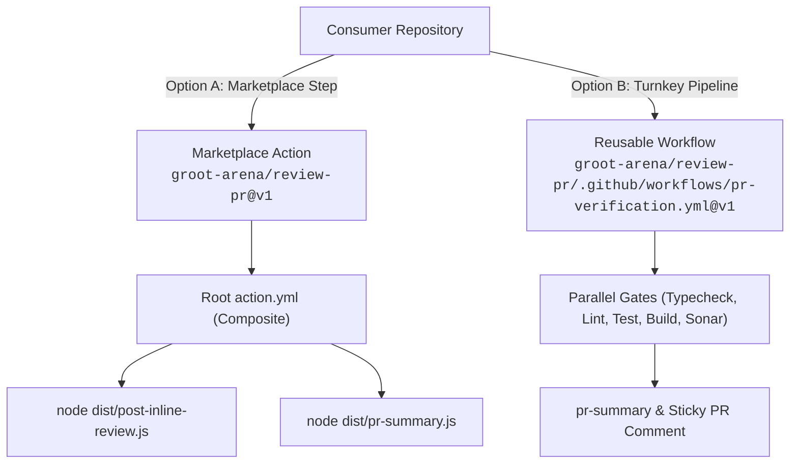

# `.ai/` Single Source of Truth (SSOT) & AI Governance Hub

Welcome to the AI Governance Hub for **`groot-arena/review-pr`**. This directory serves as the centralized **Single Source of Truth (SSOT)**, orchestrator protocol, operational rulebook, and skill catalog for all AI assistants, autonomous agents, and human contributors collaborating on this codebase.

---

## 1. System Overview & Architecture

`review-pr` is an enterprise-grade multi-language Pull Request verification engine and GitHub Marketplace Action. It ingests test, coverage, and static analysis reports, evaluates blast-radius risks, computes diff-only coverage on modified lines, posts high-signal inline reviews, and maintains an idempotent sticky PR summary report.

### Dual-Consumption Model



1. **Option A: GitHub Marketplace Action (`action.yml` at Root)**
   - Invoked via `uses: groot-arena/review-pr@v1`.
   - Single drop-in step for existing consumer CI pipelines.
   - Evaluates test results, diff coverage, inline SARIF reviews, and generates the summary comment.
2. **Option B: Turnkey Reusable Workflow (`.github/workflows/pr-verification.yml`)**
   - Invoked via `uses: groot-arena/review-pr/.github/workflows/pr-verification.yml@v1`.
   - Orchestrates parallel multi-job gates across any language (Node.js, Python, Go, Java, custom).

---

## 2. Technology Stack & Constraints

| Component | Standard / Tool | Version / Spec | Invariants & Notes |
| :--- | :--- | :--- | :--- |
| **Runtime** | Node.js | `>= 20.0.0` (Target: Node 20/22) | Native ES Modules (`"type": "module"` in `package.json`). |
| **Language** | TypeScript | `^5.7.3` | `strict: true`, `noUncheckedIndexedAccess: true`, `exactOptionalPropertyTypes: true`. |
| **Validation** | Zod | `^4.6.7` | All untrusted external inputs (XML/JSON) must parse through Zod schemas. |
| **Bundling** | esbuild | `^0.28.2` | Compiles entrypoints into self-contained CJS bundles in `dist/` with `{"type": "commonjs"}`. |
| **Testing** | Vitest | `^5.1.1` | Coverage via `@vitest/coverage-v8`. Strict 80% diff & overall coverage required. |
| **XML Parsing** | fast-xml-parser | `^5.12.1` | Ingests JUnit XML, Cobertura XML, and JaCoCo XML. |
| **Glob Matching** | picomatch | `^4.0.2` | Evaluates impact analysis patterns with `{ dot: true }`. |

---

## 3. Repository Anatomy & Module Boundaries

```text
review-pr/
├── .ai/                           # Universal AI Hub: agents, rules, and skills
├── .github/
│   ├── actions/                   # Internal composite & node sub-actions
│   │   ├── post-inline-review/    # Filters SARIF and posts inline diff reviews
│   │   ├── pr-summary/            # Renders Markdown summary and upserts sticky comment
│   │   ├── run-gate/              # Executes individual quality gate commands
│   │   └── setup-runtime/         # Configures language runtimes (Node, Python, Go, Java)
│   └── workflows/
│       ├── pr-verification.yml    # Central reusable multi-gate pipeline
│       ├── self-test.yml          # Repository CI testing and dist freshness verification
│       ├── release.yml            # Automated semantic release tagger & marketplace publisher
│       └── sonar.yml              # Dedicated SonarQube quality gate scanner
├── action.yml                     # Root GitHub Marketplace composite action entrypoint
├── config/
│   └── default-impact-rules.json  # Blast-radius rules (Docker, DB, CI/CD, Auth)
├── src/
│   ├── entrypoints/               # CLI scripts executed by action steps (post-inline-review, pr-summary)
│   ├── formatters/                # Pure renderers (pr-summary-renderer, sarif-to-review)
│   ├── github/                    # Octokit API synchronizers (comment-sync, review-sync)
│   ├── parsers/                   # Zod-validated parsers (coverage, git-diff, junit, sarif)
│   ├── types/                     # Shared TypeScript types and Zod schemas
│   └── impact-engine.ts           # Blast-radius detection engine
└── tests/
    ├── e2e/                       # Consumer repository simulation & marketplace test suites
    ├── formatters/                # Unit tests for summary and review formatting
    ├── github/                    # Unit tests for GraphQL/REST PR comment synchronization
    ├── parsers/                   # Unit tests for JUnit, LCOV, Cobertura, SARIF, and Git diff
    └── fixtures/                  # Real-world XML, SARIF, and diff report samples
```

---

## 4. Non-Negotiable Engineering Invariants

1. **Number Parsing:** Always prefer `Number.parseInt(str, 10)` and `Number.parseFloat(str)` over global `parseInt` / `parseFloat`.
2. **`dist/` Packaging Hygiene:** Never commit `dist/` directly to `main` or development branches. It is ignored via `.gitignore` and force-added only during release tagging by `.github/workflows/release.yml`.
3. **Zero Security Vulnerabilities:** `npm audit` must consistently report `found 0 vulnerabilities`. Transitive dependency vulnerabilities in `@actions/*` must be overridden via `overrides` in `package.json`.
4. **Third-Party Action Pinning:** All external GitHub Actions in `.github/workflows/*.yml` must be pinned to full 40-character commit SHAs with semantic version comments.
5. **Least-Privilege Permissions:** Workflows and jobs must explicitly declare minimal required permissions (e.g. `contents: read`).
6. **Strict Diff-Only Reviews:** Inline static analysis comments must *never* be posted on lines untouched by the PR diff.
7. **Idempotent Sticky Comments:** Sticky PR comments must use unique HTML markers (`<!-- pr-verification-report:${reportId} -->`) to prevent duplicate comments across pushes and support polyglot monorepos.

---

## 5. AI Governance Directory Navigation

The `.ai/` directory is partitioned into 3 functional pillars:

| Pillar | Directory | Purpose | Key References |
| :--- | :--- | :--- | :--- |
| **Agents** | [`.ai/agents/`](agents/) | Role personas, decision boundaries, and delegation contracts. | [`orchestrator.md`](agents/orchestrator.md), [`core-developer.md`](agents/core-developer.md) |
| **Rules** | [`.ai/rules/`](rules/) | Hard constraints, coding standards, and security invariants. | [`typescript-standards.md`](rules/typescript-standards.md), [`security-policies.md`](rules/security-policies.md) |
| **Skills** | [`.ai/skills/`](skills/) | Executable operational playbooks with exact CLI commands. | [`build-and-verify`](skills/build-and-verify/SKILL.md), [`impact-analysis`](skills/impact-analysis/SKILL.md) |

---

## 6. How AI Agents Must Execute Tasks

When assigned any request in this repository, follow the **Orchestrator Protocol** ([`.ai/rules/orchestration-protocol.md`](rules/orchestration-protocol.md)):
1. **Analyze & Inspect:** Anchor against this SSOT. Identify relevant rules in [`.ai/rules/`](rules/).
2. **Decompose:** Split tasks into atomic units (Architecture -> Implementation -> Tests -> Documentation).
3. **Delegate & Implement:** Adhere strictly to the designated agent role boundaries in [`.ai/agents/`](agents/).
4. **Verify:** Execute the [`build-and-verify`](skills/build-and-verify/SKILL.md) skill. Never consider work complete until `npm run build && npm run typecheck && npm run lint && npm test` exits with code 0.
