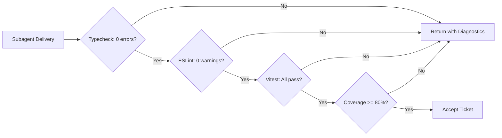

# 📜 Orchestration Protocol (`orchestration-protocol.md`)

## 1. Governing Principle
All AI agent activity within `review-pr-action` must follow the Orchestrator-Subagent model. Direct uncoordinated code modification across multiple domains is prohibited.

---

## 2. Delegation Contract Standard
Whenever the Orchestrator assigns a subtask to an agent, it must issue a contract adhering to the following schema:

```markdown
### 📋 Subtask Ticket: [TICKET-ID]
- **Assigned Agent**: [architect | core-developer | test-engineer | security-auditor | release-manager]
- **Objective**: [Precise goal of this specific subtask]
- **Allowed Target Files**:
  - `[File 1]`
  - `[File 2]`
- **Applicable Rules**:
  - `.ai/rules/[Rule File]`
- **Required Skills**:
  - `.ai/skills/[Skill Directory]/SKILL.md`
- **Acceptance Criteria**:
  1. [ ] [Deterministic Criterion 1]
  2. [ ] [Deterministic Criterion 2]
  3. [ ] [Verification Gate: typecheck, lint, test, coverage]
```

---

## 3. Subagent Operational Constraints
1. **Scope Boundaries**: A subagent must NOT modify files outside the `Allowed Target Files` list provided in its contract.
2. **Atomic Commits**: Subagents should deliver atomic, focused changes that can be independently verified.
3. **Deterministic Output**: Subagents must run relevant verification scripts before signaling task completion.
4. **No Assumption Policy**: If an ambiguity in contract criteria arises, the subagent must pause and request clarification from the Orchestrator instead of making undocumented assumptions.

---

## 4. Verification & Handoff Gate
The Orchestrator will reject any subagent handoff unless the following 4 deterministic gates pass:



```bash
# Verification execution command:
npm run typecheck && npm run lint && npm run test:coverage
```

---

## 5. Escalation & Conflict Resolution
- If two subagents have conflicting requirements (e.g., `core-developer` needs an interface change that `architect` hasn't specified), the subagent must yield control back to the Orchestrator.
- The Orchestrator will schedule a design refinement subtask for `architect` prior to resuming `core-developer` implementation.
